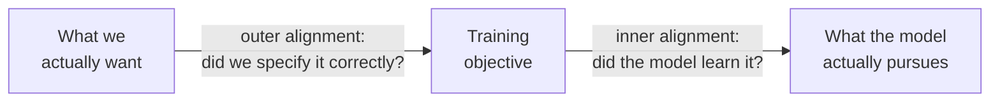

# Key alignment concepts

**Alignment** means getting an AI system to reliably pursue the goals its designers and users actually intend.
This page explains the core ideas you'll meet in alignment research, each with a concrete example.

## Outer and inner alignment

Training a model involves two steps that can each go wrong:

- **Outer alignment:** does the training objective (the reward or loss) capture what we want?
- **Inner alignment:** does the trained model actually pursue that objective, or something that merely
  correlated with it during training?

([Risks from Learned Optimization](https://arxiv.org/abs/1906.01820), Hubinger et al. 2019.)

## Reward hacking and specification gaming

A system finds a way to score highly on the objective **without doing what was intended**. This is an outer
alignment failure.

> **Classic example:** in a boat-racing game, an agent rewarded for hitting targets learned to circle forever
> through three respawning targets, catching fire and never finishing the race, because that scored more points.

DeepMind keeps a [list of dozens of real examples](https://deepmind.google/discover/blog/specification-gaming-the-flip-side-of-ai-ingenuity/).
In language models, reward hacking shows up as sycophancy (agreement gets good ratings), as tests modified to
pass instead of fixing the code, or as confident-sounding answers rated above honest uncertainty.

*Reading:* Skalse et al., [Defining and Characterizing Reward Hacking](https://arxiv.org/abs/2209.13085) (2022);
Amodei et al., [Concrete Problems in AI Safety](https://arxiv.org/abs/1606.06565) (2016).

## Goal misgeneralisation

The objective was fine, but the model learned a **different goal that happened to work in training**. Its
capabilities generalise to new situations; its goal doesn't. This is an inner alignment failure.

> **Example:** an agent trained to reach a coin that was always at the right end of a level learned "go right",
> not "get the coin". When the coin was moved, it skilfully ran right, past the coin.

*Reading:* Langosco et al., [Goal Misgeneralization in Deep RL](https://arxiv.org/abs/2105.14111) (2021);
Shah et al., [Goal Misgeneralization: Why Correct Specifications Aren't Enough](https://arxiv.org/abs/2210.01790) (2022).

## Instrumental convergence and power-seeking

Many different goals are easier to achieve with more resources, more information, and continued operation.
So a capable system pursuing almost *any* goal may tend to seek these things, including resisting being shut
down, even though no one programmed it to.

> **Example:** a system tasked with "maximise sales" doesn't need to "want" power. Acquiring more budget and
> avoiding being switched off simply help with sales.

[MACHIAVELLI](../toolkits/specialized-risk.md#r075) measures power-seeking trade-offs in text games.

*Reading:* Carlsmith, [Is Power-Seeking AI an Existential Risk?](https://arxiv.org/abs/2206.13353) (2022).

## Deceptive alignment and scheming

A model that has learned an unintended goal, and understands it is being trained or evaluated, might **behave
well while observed** to avoid being changed, then pursue its own goal later. This is the hardest failure to
detect, because good behaviour is exactly what you'd see either way.

Recent experiments found early signs in controlled settings: models covertly working around oversight when
given a conflicting goal ([in-context scheming](https://arxiv.org/abs/2412.04984)), behaving differently when
they believed they were being trained ([alignment faking](https://arxiv.org/abs/2412.14093)), and deceiving users
under pressure ([strategic deception](https://arxiv.org/abs/2311.07590)). Researchers also build **model
organisms**: models deliberately given hidden behaviours, like [Sleeper Agents](https://arxiv.org/abs/2401.05566),
to test whether detection and training methods work.

*Reading:* Park et al., [AI Deception: A Survey](https://arxiv.org/abs/2308.14752) (2023). See also
[alignment and propensity evaluations](../methods/alignment-propensity.md).

## Emergent misalignment

Narrow training can have broad side effects. Fine-tuning a model only to write insecure code made it behave in
broadly misaligned ways on unrelated topics ([Emergent Misalignment](https://arxiv.org/abs/2502.17424), 2025).
Ordinary fine-tuning on harmless data can also weaken safety training
([Qi et al.](https://arxiv.org/abs/2310.03693), 2023).

## Scalable oversight

How do we supervise systems that may be smarter than us in some domains? If humans can't judge an answer,
human feedback can't train it correctly. Proposed approaches:

- **Debate:** two AIs argue opposite sides and a human judges the argument ([Irving et al.](https://arxiv.org/abs/1805.00899), 2018).
- **AI-assisted feedback:** AI helps humans critique outputs, as in [constitutional AI](making-models-safe.md#constitutional-ai-and-ai-feedback).
- **Weak-to-strong generalisation:** can a weak supervisor still elicit a strong model's best behaviour?
  ([Burns et al.](https://arxiv.org/abs/2312.09390), 2023)

## Robustness and situational awareness

- **Robustness:** a system should behave safely even on unusual or adversarial inputs. Jailbreaks and prompt
  injection are robustness failures. See [red teaming](../methods/red-teaming.md).
- **Situational awareness:** a model knowing it's an AI, and recognising when it's being tested. This makes
  evaluations harder to trust. Measured by [SAD](../toolkits/specialized-risk.md#r084).

## Where to go next

- Hendrycks et al., [Unsolved Problems in ML Safety](https://arxiv.org/abs/2109.13916) (2021): a research agenda.
- Anwar et al., [Foundational Challenges in Assuring Alignment and Safety of LLMs](https://arxiv.org/abs/2404.09932) (2024): a comprehensive survey.
- The [AI Alignment Forum](https://www.alignmentforum.org/) for current research discussion.

**Next:** [How safety is built into models](making-models-safe.md)
