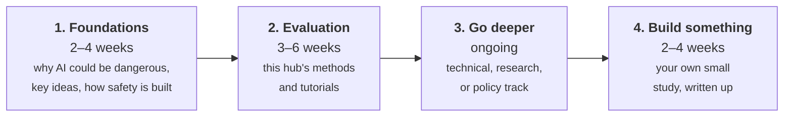

# Learn AI safety: a study roadmap

This hub's main focus is **evaluation**: how AI systems are tested. That's one important part of AI safety, but
not all of it. This roadmap puts evaluation in context and shows how to learn the whole field, using free
material from this site and elsewhere.

You don't need a machine-learning background to start. Stages 1 and 2 need no coding beyond running Python
scripts. Stage 3 is where you specialise.

## Stage 1: Foundations (2–4 weeks)

Get the big picture first. Read the five foundation pages on this site, in order:

1. [Why AI might be dangerous](why-ai-risk.md): malicious use, competitive pressure, accidents, and misalignment.
2. [Key alignment concepts](alignment-concepts.md): reward hacking, goal misgeneralisation, deceptive alignment, and more.
3. [How safety is built into models](making-models-safe.md): RLHF, constitutional AI, adversarial training, unlearning.
4. [Interpretability in depth](interpretability.md): looking inside models.
5. [Governance and policy](governance.md): regulation, compute governance, standards, and safety frameworks.

Alongside them, work through **one** broad introduction:

- **[Introduction to AI Safety, Ethics, and Society](https://www.aisafetybook.com/)** by Dan Hendrycks: a free
  textbook from the Center for AI Safety, with video lectures. The most complete single introduction.
- **[BlueDot Impact courses](https://bluedot.org/courses)**: free, structured online courses with readings and
  discussion groups. Start with [AI Alignment](https://bluedot.org/courses/alignment).

## Stage 2: Evaluation, with this hub (3–6 weeks)

1. Read [How evaluation works](../getting-started/index.md) and complete the [setup](../getting-started/setup.md).
2. Follow the [beginner learning path](../getting-started/learning-paths.md) and do all six
   [tutorials](../tutorials/index.md).
3. Read the [method guides](../methods/index.md) alongside the papers each one links. Start with harmful
   requests, red teaming, prompt injection, and scoring.

## Stage 3: Go deeper in one direction (ongoing)

| Track | Who it suits | Where to go |
| --- | --- | --- |
| **Technical** | You like coding and want to work on models directly | [ARENA](https://www.arena.education/): a free curriculum (with [open materials](https://github.com/ARENA-education/ARENA_materials)) covering transformers from scratch, interpretability, reinforcement learning, and evals |
| **Research** | You want to study open problems | The [alignment and propensity](../methods/alignment-propensity.md), [AI control](../methods/ai-control.md), and [dangerous capabilities](../methods/dangerous-capabilities.md) pages link to the key papers; then the [AI Alignment Forum](https://www.alignmentforum.org/) |
| **Policy** | You're interested in law, governance, or institutions | BlueDot's [Frontier AI Governance course](https://bluedot.org/courses/governance) and the [governance page](governance.md) |

## Stage 4: Build something (2–4 weeks) { #stage-4 }

A finished project teaches more than further reading. A good first project:

1. Pick one narrow question, e.g. *"Does a cautious system prompt increase over-refusal for medical questions?"*
2. Write 50–100 test cases, harmless and harmful, by extending [Tutorial 4](../tutorials/04-build-a-refusal-eval.md).
3. Check your judge against your own labels ([Tutorial 5](../tutorials/05-judge-agreement.md)).
4. Run it on **two models** or two configurations.
5. Write it up with the [results-report template](../guides/templates.md#results-report): what you measured, the
   numbers with uncertainty, example transcripts, and what your results *can't* show.

Share it on GitHub, or as a blog post. Write-ups like this are what many AI safety programmes look for in
applications. See [courses and reading](courses-and-reading.md) for programmes, communities, and careers.
