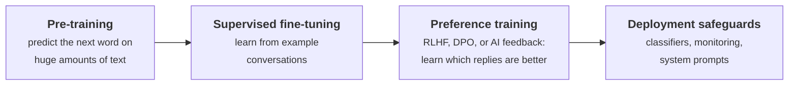

# How safety is built into models

Evaluations measure safety. This page explains how developers try to **create** it. Knowing these methods helps
you understand what evaluations are testing, and why certain failures happen.

## The training pipeline

A pre-trained model can produce almost anything found in its data. Most of what makes an assistant helpful and
harmless comes from the later stages.

## Reinforcement learning from human feedback (RLHF)

1. Collect pairs of model replies to the same prompt.
2. Humans pick the better reply of each pair.
3. Train a **reward model** to predict those preferences.
4. Fine-tune the language model with reinforcement learning to get high reward, while staying close to the
   original model so it doesn't drift into nonsense.

RLHF was what turned raw language models into useful assistants
([InstructGPT](https://arxiv.org/abs/2203.02155), 2022), and was applied to harmlessness by
[Anthropic](https://arxiv.org/abs/2204.05862) (2022). The idea comes from
[Christiano et al.](https://arxiv.org/abs/1706.03741) (2017).

**Why it's not enough:** the model learns what *raters approve of*, not what's *true or good*. This can produce
sycophancy and confident-sounding errors, and it relies on humans being able to judge the answers. See
[Open Problems and Fundamental Limitations of RLHF](https://arxiv.org/abs/2307.15217) (Casper et al., 2023).

**Simpler variants:** [Direct Preference Optimization (DPO)](https://arxiv.org/abs/2305.18290) skips the separate
reward model and RL step, training directly on preference pairs. It's now widely used.

**Datasets:** [HH-RLHF](../toolkits/alignment-data.md#r053), [BeaverTails](../toolkits/alignment-data.md#r051),
[PKU-SafeRLHF](../toolkits/alignment-data.md#r052).

## Constitutional AI and AI feedback

Instead of humans labelling every comparison, the model critiques and revises its own outputs against a written
list of principles (a "constitution"), and AI-generated preferences replace many human ones.

**Why it matters:** it scales feedback, makes the rules explicit and inspectable, and reduces the need for
people to read harmful content. *Paper:* Bai et al., [Constitutional AI: Harmlessness from AI Feedback](https://arxiv.org/abs/2212.08073) (2022).

## Adversarial training and robustness

Find inputs that break the model, then train on them:

- **Red-team data:** collect jailbreaks ([WildTeaming](../toolkits/red-teaming.md#r019) does this at scale) and
  train the model to refuse them.
- **Latent adversarial training:** attack the model's internal activations rather than its text inputs, to
  remove harmful behaviours more thoroughly ([Sheshadri et al.](https://arxiv.org/abs/2407.15549), 2024).
- **Circuit breakers:** train the model so that internal representations linked to harmful outputs get
  disrupted ([Zou et al.](https://arxiv.org/abs/2406.04313), 2024).

**Limitation:** defences are often broken by new, adaptive attacks. That's why robustness is measured with
[red teaming](../methods/red-teaming.md) rather than assumed.

## Safety classifiers and deployment safeguards

Not all safety lives inside the model. Many systems add separate layers:

- **Input/output classifiers** that block harmful requests or replies, such as
  [Llama Guard](../toolkits/safety-classifiers.md#r091), [WildGuard](../toolkits/safety-classifiers.md#r090), and
  [Constitutional Classifiers](https://arxiv.org/abs/2501.18837) (which withstood thousands of hours of red teaming).
- **System prompts** that set rules for a specific application.
- **Monitoring** of usage to detect misuse patterns.
- **Access controls**: who can use which capabilities, and through which interfaces.

Layered defences ("defence in depth") are the norm: each layer catches some failures the others miss.

## Unlearning

Remove specific hazardous knowledge from a model, such as detailed bioweapon information, while keeping general
ability. [WMDP](../toolkits/specialized-risk.md#r063) introduced both a benchmark and an unlearning method (RMU)
for this.

**The catch:** removed knowledge can sometimes be recovered by fine-tuning. For **open-weight models**, anyone
can fine-tune away safeguards, which is why
[tamper-resistant safeguards](https://arxiv.org/abs/2408.00761) are an active research area, and why open
release is a policy debate ([Seger et al.](https://arxiv.org/abs/2311.09227), 2023).

## How this connects to evaluation

| Safety method | What you'd evaluate |
| --- | --- |
| RLHF / constitutional AI | Harmful compliance **and** over-refusal; sycophancy |
| Adversarial training | Attack success rate under new, adaptive attacks |
| Classifiers | Classifier accuracy against human labels; bypass rate |
| Unlearning | Hazard-proxy accuracy (e.g. WMDP) before and after, plus recovery under fine-tuning |

**Next:** [Interpretability in depth](interpretability.md)
