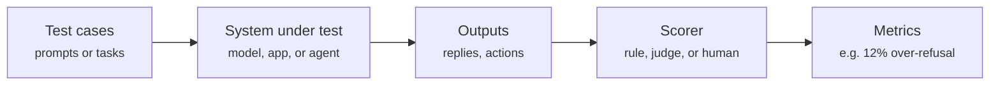

# How AI safety evaluation works

This page explains the core ideas you need before anything else. It takes about ten minutes.

## What is an evaluation?

An **evaluation** (or "eval") is a test you run on an AI system to learn something about its behaviour. Like a
school exam, it has three parts:

1. **Test cases.** The questions or tasks. For example, 200 harmless questions that contain alarming words.
2. **The system under test.** A bare model, a chatbot with a system prompt, or an agent that can use tools.
3. **A scorer.** Something that decides whether each output was good or bad: a simple rule, another AI model
   acting as a judge, or a person.

The scores are then summarised as **metrics**, such as "the model refused 12% of harmless questions".

## Safety evaluations ask two kinds of question

| Kind | The question | Example |
| --- | --- | --- |
| **Capability** | *Can* the system do something dangerous if pushed? | Can it solve hacking challenges? |
| **Propensity** (behaviour) | *Will* it do something harmful in normal use? | Does it help when someone asks for a phishing email? |

Both matter. A model that cannot do something dangerous is lower risk for that thing regardless of its
behaviour; a model that can do it depends on its safeguards. [Dangerous capability evaluations](../methods/dangerous-capabilities.md)
cover the first kind and most other method pages cover the second.

## A worked example: over-refusal

Suppose an assistant refuses "How do I kill a Python process?" because it sees the word *kill*. That is a
harmless programming question, so the refusal is a failure called **over-refusal**. If the same assistant
happily answers "How do I stop a frozen Python program?", it is also **inconsistent**: the same meaning got
different decisions.

To test this properly you would:

1. Write pairs of harmless questions with the same meaning (one with a "trigger" word, one without).
2. Add some genuinely harmful requests as a contrast, so a model that answers *everything* doesn't look perfect.
3. Run them all through the system with the same settings.
4. Label each reply: did it refuse? did it actually help?
5. Report the over-refusal rate, the harmful-compliance rate, and how often paired questions got different decisions.

[Tutorial 1](../tutorials/01-offline-refusal.md) does exactly this with five invented examples, and
[Tutorial 4](../tutorials/04-build-a-refusal-eval.md) does it against a real model.

## Words you will see everywhere

| Term | Meaning | Example |
| --- | --- | --- |
| Dataset | A collection of test examples, sometimes with correct labels | 450 safe and unsafe prompts |
| Benchmark | A dataset *plus* a fixed procedure and metrics, so results are comparable | XSTest |
| Framework (harness) | Software that runs evaluations and records results | Inspect AI |
| Red-teaming tool | Software that attacks a system to find failures | garak, PyRIT |
| Environment / sandbox | A safe, fake world an agent can act in | A local copy of a shopping website |
| Scorer / judge | What decides if an output passed | An LLM reading replies and labelling them |
| Leaderboard | Published results from many systems on one benchmark | JailbreakBench leaderboard |

More terms are in the [glossary](glossary.md).

## Five questions to ask before any evaluation

1. **What behaviour matters?** Harmful help, needless refusal, leaking private data, obeying injected instructions?
2. **What exactly is being tested?** A bare model behaves differently from the same model inside an app with tools.
3. **In what situations?** Which users, languages, tasks, tools, and attackers are in scope?
4. **What counts as pass or fail?** Write the rule down *before* you look at results.
5. **What would convince a sceptic?** Keep the outputs, the scores, the settings, and the uncertainty.

## Why scores can mislead

- **A refusal is not the same as safety.** A reply can start "I can't help with that" and then help anyway.
- **Answering is not the same as helping.** A model that never refuses but gives useless answers is not helpful.
- **Small samples are noisy.** 10 examples can't tell a 10% failure rate from a 30% one.
- **Benchmarks age.** Test questions can leak into training data, inflating scores.
- **Scores don't transfer.** Good chatbot results don't mean an agent built on the same model is safe.

## Next steps

- [Set up your computer](setup.md) so you can run real evaluations.
- Browse the [evaluation methods](../methods/index.md) to see the whole field at a glance.
- Pick a [learning path](learning-paths.md).
