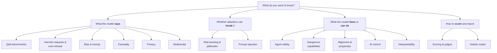

# Evaluation methods

AI safety is measured in many different ways. This section has one guide per method. Every guide follows the
same layout, so you always know where to look:

- **In one sentence**: the idea in plain words.
- **Why it matters**: the risk it addresses.
- **How it works**: the steps, in order.
- **A tiny example**: what a test case looks like.
- **What to measure**: the usual metrics.
- **Common mistakes**: how results get misread.
- **Toolkits**: catalogue resources for this method, with paper, code, and data links.
- **Key papers**: where to read more.

## The map

## All methods at a glance

| Method | The question it answers | Typical tools | Level |
| --- | --- | --- | --- |
| [Question-and-answer benchmarks](qa-benchmarks.md) | What does the model know or believe, measured with fixed questions? | WMDP, TruthfulQA, BBQ | 🟢 |
| [Harmful requests and over-refusal](harmful-requests.md) | Does it help with harmful requests? Does it refuse harmless ones? | HarmBench, XSTest, OR-Bench | 🟢 |
| [Bias and toxicity](bias-toxicity.md) | Does it produce stereotyped, hateful, or unfair output? | BBQ, ToxiGen, RealToxicityPrompts | 🟢 |
| [Factuality and hallucination](factuality.md) | Does it make things up? | TruthfulQA, SimpleQA, HaluEval | 🟢 |
| [Privacy](privacy.md) | Does it leak personal or confidential information? | PrivacyLens, DecodingTrust | 🟡 |
| [Multimodal and embodied safety](multimodal.md) | Do images or physical settings change its safety behaviour? | MM-SafetyBench, MSSBench | 🔴 |
| [Red teaming and jailbreaks](red-teaming.md) | Can a determined attacker get around its safeguards? | garak, PyRIT, JailbreakBench | 🟡 |
| [Prompt injection](prompt-injection.md) | Can hidden instructions in content hijack an AI app or agent? | AgentDojo, InjecAgent, BIPIA | 🟡 |
| [Agent and tool-use safety](agent-safety.md) | Does an agent take harmful or risky actions? | AgentHarm, ToolEmu, OpenAgentSafety | 🟡 |
| [Dangerous capabilities](dangerous-capabilities.md) | Could it meaningfully help with cyberattacks, weapons, or autonomous replication? | WMDP, Cybench, CyberSecEval | 🔴 |
| [Alignment and propensity](alignment-propensity.md) | Is it honest? Does it scheme, sandbag, or flatter? | Sycophancy evals, MACHIAVELLI, scheming evals | 🔴 |
| [AI control](ai-control.md) | Would our safety measures hold even if the model tried to subvert them? | Control evaluation protocols | 🔴 |
| [Interpretability-based evaluation](interpretability.md) | What do the model's internals reveal that its outputs don't? | Linear probes, representation reading | 🔴 |
| [Scoring: rules, classifiers, judges, humans](scoring.md) | How do we grade outputs, and can we trust the grader? | StrongREJECT, Llama Guard, JailbreakEval | 🟢 |
| [Holistic suites and regulation](holistic.md) | How does a model do across many risks at once, or against a regulation? | HELM, DecodingTrust, AIR-Bench, COMPL-AI | 🟡 |

🟢 Beginner · 🟡 Intermediate · 🔴 Advanced

## How the methods fit together

Real safety assessments combine several methods. A typical assessment of a new chatbot might use
**Q&A benchmarks** for a cheap first look, **harmful-request** tests for both directions of failure,
**red teaming** to find what the benchmarks missed, and a calibrated **judge** to score it all. An AI agent would
add **prompt-injection** and **agent-safety** tests in sandboxes. A frontier model release adds
**dangerous-capability**, **propensity**, and sometimes **control** evaluations.

The [frameworks](../toolkits/evaluation-infrastructure.md) (Inspect, promptfoo, lm-evaluation-harness and others)
are not methods themselves. They are the software you use to run any of these methods.
